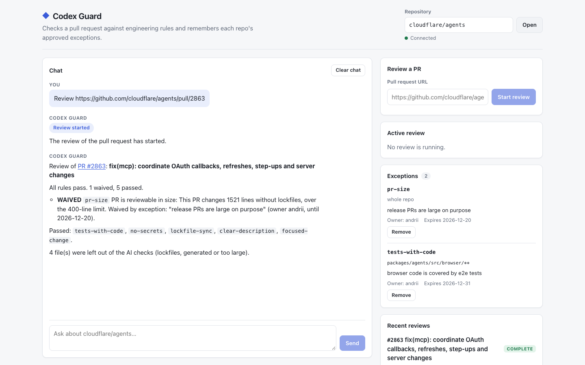
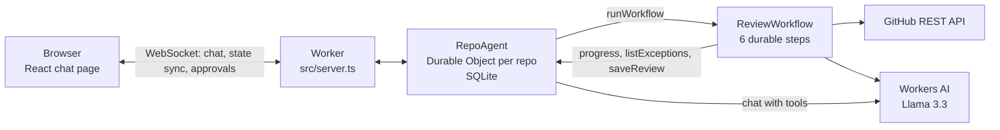

# Codex Guard

Codex Guard checks a GitHub pull request against a small set of engineering rules and remembers each repo's approved exceptions. You talk to it in a chat: start a review, ask about the findings, or ask for a time-boxed exception that you then approve in the page. Each repo gets its own agent, so its exceptions and review history stay with it.

Live app: https://codex-guard.gryyny.workers.dev (try [`?repo=cloudflare/agents`](https://codex-guard.gryyny.workers.dev/?repo=cloudflare/agents) and paste a PR URL from that repo).

Why this idea: the Developer Productivity team turns engineering standards into automated guardrails and runs the exception process around them. Codex Guard is that in miniature: rules as code, an LLM for the rules code can't check, and exceptions with a reason, an owner and an expiry date that need human approval.



## The four required parts

| Part | How Codex Guard covers it |
| --- | --- |
| LLM | Llama 3.3 70B on Workers AI (`@cf/meta/llama-3.3-70b-instruct-fp8-fast`). It judges two rules in JSON mode and runs the chat with tools. |
| Workflow / coordination | Each review is a Cloudflare Workflow (`AgentWorkflow`) with six durable steps. A Durable Object per repo coordinates reviews, chat and exceptions. |
| User input | A React chat page served as Workers static assets, connected to the agent over WebSocket. A "Review a PR" form starts reviews directly. |
| Memory / state | SQLite in each repo's Durable Object: exceptions, review reports and chat history. Agent state is synced live to every open page. |

## Architecture



1. The page opens a WebSocket to `/agents/repo-agent/<owner.repo>`. The Worker only routes names that are valid `owner.repo` pairs.
2. A review starts from the form (a `@callable` method) or from the chat (`reviewPullRequest` tool). The agent writes a `running` row and starts the Workflow.
3. The Workflow runs `fetch-pr`, `fetch-files`, `code-checks`, `llm-checks`, `apply-exceptions` and `save`. It reports progress to the agent after each step.
4. On `save` the agent stores the report, updates its state and posts a summary to the chat. The page gets both over the open WebSocket.

## Rules

The rules live in `src/shared/contracts.ts`. Code rules are plain TypeScript in `src/codex`. LLM rules send their rule text to the model.

| Rule id | What breaks it | Severity | Checked by |
| --- | --- | --- | --- |
| `tests-with-code` | Source files change but no test file changes | fail | code |
| `no-secrets` | An added line looks like a private key, cloud or API token, or a hard-coded credential | fail | code |
| `lockfile-sync` | A manifest (`package.json`, `go.mod`, `Cargo.toml`, `pyproject.toml`, `Gemfile`) changes dependencies without its lockfile | fail | code |
| `pr-size` | More than 400 changed lines, lockfiles not counted | warn | code |
| `clear-description` | The description does not explain what changes and why | fail | LLM |
| `focused-change` | The diff has notable changes the title and description do not mention (supporting tests, docs and small refactors are fine) | warn | LLM |

Each finding is `pass`, `fail`, `warn`, `waived` or `error`. If the LLM step fails, its two rules become `error` and the code findings still stand.

## Exceptions life cycle

1. **Request.** In the chat, ask for an exception. The model needs the rule id, a reason, an owner and an expiry date (at most 180 days ahead). A path glob such as `src/generated/**` is optional. If a field is missing, it asks.
2. **Validate.** The input is checked in code. Invalid input never reaches the approval step; the error goes back to the model.
3. **Approve.** `addException` is a `needsApproval` tool. Nothing is saved until a person clicks Approve in the page. Removing one from the chat needs approval too; the Remove button in the side panel asks for an inline confirm. In this public demo there is no login, so the person who approves is whoever has the page open (see Limits).
4. **Apply.** On the next review, an active exception turns a matching `fail` or `warn` into `waived` and the report shows its reason. A path exception waives only the paths it covers.
5. **Expire.** After the expiry date the exception stops working. The finding is `fail` or `warn` again, with a note that the exception expired.

## Design choices

- **One Durable Object per repo.** Exceptions never leak between repos. SQLite sits next to the code that uses it, and there is a single writer per repo.
- **WebSocket, not SSE.** The server pushes review results after the Workflow ends, approvals and state sync share one connection, and a Durable Object can hibernate with an open WebSocket.
- **Review as an `AgentWorkflow`.** Six durable steps with their own retry settings. The Workflow reports progress and the final report back to the agent.
- **Code checks first, the LLM only for two rules.** Code rules are deterministic and free. The LLM gets a capped, filtered diff (no lockfiles, generated or vendored files; about 40k characters) because Llama 3.3 on Workers AI has a 24k-token context.
- **PR content is untrusted data.** The LLM prompt wraps title, description and diff in delimiters, neutralizes those delimiters in the content, and tells the model not to follow instructions inside them.
- **Exceptions only through a `needsApproval` tool.** The model can propose an exception but cannot save one without a click in the page.
- **Clients only read state.** Agent state is synced to every page, but `validateStateChange` rejects changes that do not come from the agent itself.
- **The form calls the agent directly.** "Review a PR" does not go through the model, so reviews work even if the model calls tools badly.
- **Review summaries are posted without a model call.** The agent renders the report to markdown in code, so the result in the chat is exactly what the checks found.
- **Workers static assets instead of Pages.** Cloudflare now recommends Workers for new full-stack apps. One deploy ships the page, the Worker, the Durable Object and the Workflow.

## Limits and next steps

- Workers AI free allocation is 10,000 neurons a day: about 20 reviews a day plus chat.
- Public repos only (the GitHub token is read-only, public repositories).
- No login. Anyone with the link can start reviews, approve or remove exceptions and clear the chat. Approval is a UI step here, not an access control. A real tool would sit behind Cloudflare Access and take the exception owner from the signed-in identity.
- No rate limit yet. A Workers Rate Limiting binding per IP is the next step; until then the free-plan limits cap the cost.
- One review at a time per repo. A review that never reports back is released after 15 minutes.
- Cross-repo reporting (for example, all exceptions expiring this week) needs a shared store. D1 is the obvious next step.

## Run, test, deploy

Run locally:

```sh
npm install
cp .dev.vars.example .dev.vars   # add a fine-grained GitHub token: read-only, public repositories
npx wrangler login               # Workers AI has no local simulator, so dev calls the real one
npm run dev
```

Open the URL Vite prints. `?mock=1` shows the page with mock data and no backend.

Test:

```sh
npm test
npm run typecheck
```

Deploy:

```sh
npx wrangler login
npx wrangler secret put GITHUB_TOKEN
npm run deploy
```

## Project layout

```
src/
  shared/contracts.ts   Types, rules and naming shared by every module
  codex/                Rules engine: code checks, LLM input, exceptions (pure TypeScript)
  review/               ReviewWorkflow, GitHub client, LLM rule judge
  agent/                RepoAgent Durable Object: SQLite, chat tools, system prompt, report markdown
  client/               React chat page (repo picker, chat, review form, exceptions, recent reviews)
  server.ts             Worker entry: routes /agents/* to the repo agent
wrangler.jsonc          Worker, assets, AI binding, Durable Object and Workflow config
```

## How it was built

Built on 2026-11-18 with Claude Code. Before any code, the plan was checked against the current Cloudflare docs and written up as one page: [Codex Guard plan](https://claude.ai/artifact/3P1xrF1HoPesVB9Z86eVTU) (idea, architecture, review steps, rules, memory, free-plan budget, build order). The lead agent wrote the shared contracts first (`src/shared/contracts.ts`). Four agents then built the rules engine, the review workflow, the repo agent and the chat page in parallel git worktrees, one owned folder each. The lead merged their branches, deployed, tested on real `cloudflare/agents` PRs and fixed what it found. An independent agent reviewed the code at the end. The full prompt history is in [PROMPTS.md](PROMPTS.md).
